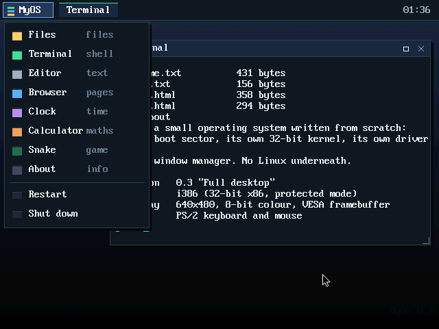

# MyOS

**A desktop operating system written from scratch — and runnable in a browser tab.**

Eight apps, resizable windows, a start menu, a live clock, and a real shell.
No installation, no account, no downloads.

> ### ▶ Boot it: **https://cdn.jsdelivr.net/gh/thefirstacc164/My-OS@main/docs/index.html**
> Click **POWER ON**, then click **MyOS** in the top-left corner to open the start menu.
> (The permanent address `https://thefirstacc164.github.io/My-OS/` works after a one-time
> switch in the repository settings — see [Hosting](#hosting--why-it-is-free).)



---

## What this is

Not a menu screen, and not a Linux you configured. This is a hand-written
operating system for 32-bit x86, from the first byte the CPU executes.

| | |
|---|---|
| **Boot sector** | 512 bytes of assembly: memory map, kernel loader, A20, GDT, protected mode, VESA mode |
| **Kernel** | ~50 KB of C: interrupts, timer, keyboard, mouse, graphics, window manager, shell, apps |
| **Display** | 640×480, 8-bit colour, VESA linear framebuffer, drawn pixel by pixel |
| **Input** | PS/2 keyboard and mouse, both interrupt driven |
| **Storage** | a small in-memory file system (its own tree, files and sizes) |
| **Desktop** | splash screen, wallpaper, start menu, taskbar, live clock, movable/resizable windows |
| **Apps** | Files, Terminal, Editor, Browser, Clock, Calculator, Snake, About |

It runs on **v86**, an x86 PC emulator written in Rust and compiled to WebAssembly.
The emulated BIOS reads the first sector of our disk image, jumps into our boot
sector, and from there every instruction is ours.

---

## Using it

1. Open the link at the top in any modern browser.
2. Click **POWER ON** (the first load pulls ~5 MB of emulator files).
3. Click **MyOS** in the top-left corner for the start menu.

| Window control | How |
|---|---|
| Move | drag the title bar |
| Resize | drag the bottom-right corner |
| Maximise / restore | click `□` in the title bar |
| Close | click `×` in the title bar |
| Bring to front | click the window, or its button in the taskbar |

| App | What it does |
|---|---|
| **Files** | Browse the file system, open folders, click a file to open it |
| **Terminal** | `help`, `ls`, `cat`, `write`, `rm`, `open`, `mem`, `cpu`, `date`, `uptime`, `echo`, `clear`, `logo`, `reboot`, `halt` |
| **Editor** | Type into a file, `Save` writes it back, arrow keys move |
| **Browser** | Renders `.html` files from the file system: headings, paragraphs, bullets, clickable links |
| **Clock** | Analogue dial with hour, minute and second hands, driven by the CMOS chip |
| **Calculator** | Integer maths, by mouse or keyboard (`7*8=`) |
| **Snake** | Arrow keys to steer, click to play again |
| **About** | Live system information: display mode, RAM, uptime, CPU vendor |

The start menu also has **Restart** and **Shut down** — those really do reset the
emulated machine or halt the CPU.

Everything is in RAM: reboot and the machine is factory-fresh again.

---

## How it boots

```
   power on
      │
      ▼
  BIOS (SeaBIOS inside the emulator)
  reads sector 0 of myos.img ──────────►  512-byte boot sector
                                                │ 1. BIOS memory map        (INT 15h / E820)
                                                │ 2. read kernel from disk (INT 13h / CHS)
                                                │ 3. open the A20 line
                                                │ 4. VESA mode 640x480x8   (INT 10h / 4F02)
                                                │ 5. GDT, CR0.PE
                                                ▼
                                        32-bit protected mode @ 0x10000
                                                │
                                                ├── gfx       framebuffer + 8x16 font
                                                ├── console   text output, boot log
                                                ├── idt/pic   interrupts, exception reporting
                                                ├── pit       100 Hz clock
                                                ├── keyboard  PS/2, IRQ1
                                                ├── mouse     PS/2, IRQ12
                                                ├── fs        in-memory files
                                                └── wm        splash, desktop, windows, apps
```

The boot sector leaves data behind at fixed addresses for the kernel:
the BIOS memory map at `0x5000`, and the VESA mode information block at `0x4800`
(framebuffer address, pitch, resolution).

---

## How the desktop works

There is no compositor and no damage tracking to speak of: every change redraws
the whole 640×480 frame into a back buffer in RAM, then copies it to video memory
in one go, so nothing flickers. A frame takes about 2 ms in the emulator.

Windows are just rectangles with a draw callback. The window manager owns:

- **z-order** — an array of window indices, bottom to top; raising moves one to the end
- **focus** — the top window gets the keyboard
- **hit testing** — title bar, close box, maximise box, resize grip, or the app's own content
- **ticks** — apps with a `tick` callback run about 100 times a second, which is how
  the clock's second hand moves and how Snake steps

Apps draw into their content rectangle and get content-relative click coordinates.

---

## Source map

```
boot/boot.S          the 512-byte boot sector (assembly)
kernel/entry.S       entry point, interrupt stubs
kernel/main.c        boot log, driver start-up, splash screen
kernel/gfx.c         framebuffer, palette, drawing, 8x16 font renderer
kernel/console.c     text console (screen or window buffer) + printf
kernel/wm.c          splash, wallpaper, start menu, taskbar, windows, input
kernel/apps.c        Files, Terminal, Editor, Browser, Clock, Calculator, Snake, About
kernel/fs.c          in-memory file system
kernel/idt.c         IDT, PIC remapping, CPU exception reporting
kernel/pit.c         system timer
kernel/keyboard.c    PS/2 keyboard driver (US layout, shift, caps, arrows)
kernel/mouse.c       PS/2 mouse driver (3-byte packets, IRQ12)
kernel/rtc.c         CMOS clock
kernel/memory.c      E820 memory accounting
kernel/string.c      memcpy / memset / strcmp / ...
tools/mkfont.py      pulls the 8x16 font out of the VGA BIOS at build time
tools/mkimage.py     builds the bootable 1.44 MB floppy image
tools/selftest.js    boots the image headlessly, clicks and types
docs/                the website (GitHub Pages / jsDelivr)
```

## Building it

You need `gcc`, `as`, `ld`, `objcopy` and `python3`:

```sh
make          # produces docs/myos.img
make clean
```

The Makefile compiles the kernel, counts how many 512-byte sectors it needs,
bakes that number into the boot sector, generates the font, and assembles the
floppy image.

## Testing it

`tools/selftest.js` boots the exact published image in v86, then drives the
desktop with real PS/2 packets and scancodes — it opens the start menu, launches
apps, types in the terminal, clicks a link, maximises a window and shuts down:

```sh
npm install v86
node tools/selftest.js
```

```
  ok   kernel boots
  ok   VESA framebuffer initialised
  ok   mouse driver started
  ok   file system mounted
  ok   the start menu opens
  ok   the menu opens the Terminal
  ok   typing runs a shell command
  ok   ls lists the file system
  ok   mem reads the BIOS memory map
  ok   the Browser opens from the menu
  ok   clicking a link navigates
  ok   the Files window opens
  ok   the maximize button maximises
  ok   clicking again restores the window
  ok   the Clock opens
  ok   the Calculator opens
  ok   Snake opens
  ok   the Shut down menu item halts MyOS

all checks passed
```

---

## Hosting — why it is free

`docs/` is a plain static folder. The emulator (`v86`, BSD-2-Clause) and the
BIOS ROMs (SeaBIOS/VGABIOS, LGPL) are vendored inside it, so the page needs no
server, no API key and no account.

1. **jsDelivr** (already live, zero setup) — serves any public GitHub folder:
   `https://cdn.jsdelivr.net/gh/thefirstacc164/My-OS@main/docs/index.html`
2. **GitHub Pages** (permanent, nicer URL) — enable once:
   <https://github.com/thefirstacc164/My-OS/settings/pages> →
   *Deploy from a branch* → **main** + **/docs** → Save.

---

## Honest limits

This is a real desktop, but a small one. There is no multitasking (apps share one
loop), no networking, no 64-bit mode, no user accounts, and the file system lives
in RAM — rebooting wipes any file you made.

Natural next steps: files that survive a reboot (needs a disk driver), a settings
app with themes, right-click menus, wallpaper switching, and sound.

---

## Licences

- MyOS source: MIT (see `LICENSE`).
- v86: BSD-2-Clause — `docs/v86/LICENSE`.
- SeaBIOS and VGABIOS: LGPL — `docs/bios/COPYING.LESSER`.
